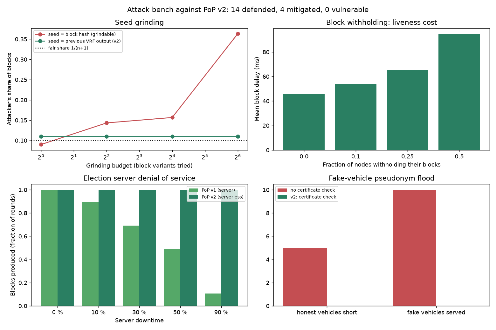
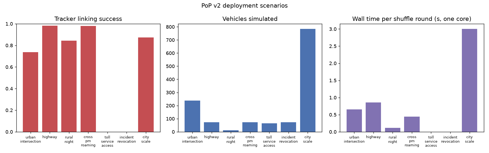

# Attack bench and deployment scenario results

Back to the [README](../README.md). Mechanisms in [attacks_and_usecases.md](attacks_and_usecases.md).

## Attack bench

`pop-sim attacks` executes eighteen attacks against the implementation and reads
the outcome from what honest nodes accept. It exits non-zero if any attack
succeeds, so CI runs it on every push. Full table and mechanisms in
[attacks_and_usecases.md](attacks_and_usecases.md); raw output in
`results/v2/attacks.json`. Result of the full run: **14 defended, 4 mitigated,
0 vulnerable**, under the bench's default *oracle* attribution (the RSU is told the
true sender of every message). Under *ledger* attribution, what a real RSU can do, one
outcome changes: *revoked vehicle keeps transmitting* becomes vulnerable (E6 of the
[recycling study](recycling_results.md)).

| Attack | What was tried | Measured outcome |
|---|---|---|
| Value forgery / proof theft | Claim a smaller value, reuse the winner's proof, use an uncertified key, choose the seed | 0 of 4 accepted, honest block accepted |
| Sortition threshold tampering | A node with value 0.94 writes `threshold: 1.0`, `miners: 0`, or claims a no-miner round with or without evidence | 0 of 4 accepted, honest block accepted (an earlier verifier accepted the first two: review finding, fixed in 2.2.1) |
| Seed grinding | Previous winner tries 1 to 64 block variants to lower its next value | Block-hash seed: share rises from 0.09 to 0.36. Chained VRF seed (v2): stays at 0.11 (fair share 0.10) |
| Multi-key seed choice | Attacker with 1 to 5 certified keys picks which winning key publishes to steer the next seed | Share 0.06 / 0.12 / 0.16 / 0.18 for k = 1 / 2 / 3 / 5 against fair 0.05 / 0.10 / 0.14 / 0.21; no measurable gain over honest play |
| Block withholding | 0 to 50 % of nodes never publish when they win | 0 attacker blocks; mean block delay 46 ms to 95 ms; no round without a block |
| Equivocation | Two blocks, one proof | First block stands, second rejected, node reported |
| Proof replay | Old proof at a new height | Rejected |
| Election server DoS | Server down 10 to 90 % of the time | v1 produces 89 % to 11 % of its blocks; v2 100 % |
| Sybil election keys | 50 self-generated keys publish blocks | 0 accepted |
| Network partition | Two halves elect for 10 heights | 10 wasted blocks, deterministic convergence on healing |
| Pseudonym replay | 2 OBUs reuse returned pseudonyms | Both revoked, 0 honest vehicles revoked |
| Pseudonym cloning | Copied pseudonym 4 km away one second later, and from another sender | Both rejected (clone check, holder binding) |
| Forged pseudonym / package | Self-minted credentials to RSU and PM | Unknown pseudonym; package rejected |
| Fake-vehicle flood | 30 forged-certificate vehicles at one RSU | Without the check: 10 fakes served, 5 honest vehicles short. With v2's check: 0 and 0, 60 requests refused |
| Revoked vehicle persists | Keeps transmitting, asks for new sets | 0 messages accepted, no new sets |
| RSU chain rewrite | RSU edits a transaction and re-hashes its chain | Detected from the PM-level anchors |
| Curious RSU | Reads neighbours' transactions | 0 of 6 opened |
| Location tracking | Kalman/GNN tracker across changes | Sparse road 100 % linked; dense synchronized zone with 10 s silence 48 %; same zone unsynchronized 62 % |

Five of these defences did not exist before the bench was written and were added
because it found them necessary: the chained VRF seed (grinding), equivocation
detection, the certificate check at allotment (flood), the ledger clone check, and
the constant threshold with fallback evidence (found by an external review of the
code, the only one that was a real hole in a shipped version).

## Deployment scenarios

`pop-sim usecases` runs the protocol in seven settings an operator might deploy it
in (`results/v2/usecases.json`, configurations included so each can be re-run with
`pop-sim bench`). Linking success is the fraction of pseudonym changes a kinematic
tracker follows; below 0.35 is reported as adequate, above 0.7 as insufficient.

| Scenario | Setting | Vehicles | Linking | Stock-outs | Round (one core) | Verdict |
|---|---|---|---|---|---|---|
| Urban intersection | 2 km, 60 veh/km, 30 km/h, shuffle 20 s, 5 s silence | 237 | 0.74 | 0 | 0.7 s | Insufficient: the tracker follows a vehicle for 25 s on average; even 9 s of silence in every 10 s period leaves 0.52 |
| Highway | 12 km, 4 veh/km, 110 km/h, shuffle 60 s | 72 | 0.98 | 8 | 0.9 s | Insufficient: tracker follows for 185 s on average; needs silence at entries/exits |
| Rural night | 6 km, 1 veh/km | 11 | 0.84 | 0 | 0.1 s | Insufficient: a lone vehicle is tracked for 78 s on average; shuffling alone does not help |
| Cross-PM roaming | Two PMs on a 6 km ring | 72 | 0.98 | 0 | 0.4 s | 42 crossings; 33 anchored proofs verified (1.6 KB, 27 us); 9 fell back to the ledger |
| Toll / service access | Gantry authenticates by pseudonym | 65 | n/a | n/a | n/a | 63 accepted, 2 revoked rejected, 123 us per check, 0 permanent identities exposed |
| Incident revocation | 3 misbehaving vehicles, 2 PMs | 72 | n/a | n/a | n/a | 3 of 3 revoked within 2 rounds, 0 honest vehicles affected, CRL of 3 |
| City scale | 4 PMs x 5 RSUs, 20 km, 20 veh/km | 784 | 0.87 | 1 | 3.0 s | 11,760 signed CAMs per 30 s round, PM election 0.4 ms: one core keeps up with a district |

Linking success is against the Kalman/GNN tracker (the conservative adversary).

What the scenarios say together: PoP v2's authentication, revocation and roaming
work where the manuscript places them (service access, revocation across operators,
roaming between PMs, a district on one core). Its location privacy does not: against
the Kalman tracker no scenario reaches the adequate band, including the dense
intersection the manuscript names as the place to shuffle (0.74 at 5 s of silence,
0.52 even when vehicles stay silent for 9 s of every 10 s period). Results before
3.3.0 put the intersection at 0.35, "adequate, just": that run predated the
Kalman tracker. Pseudonym change, shuffled or not, is not a location-privacy
mechanism against a competent eavesdropper on its own.

