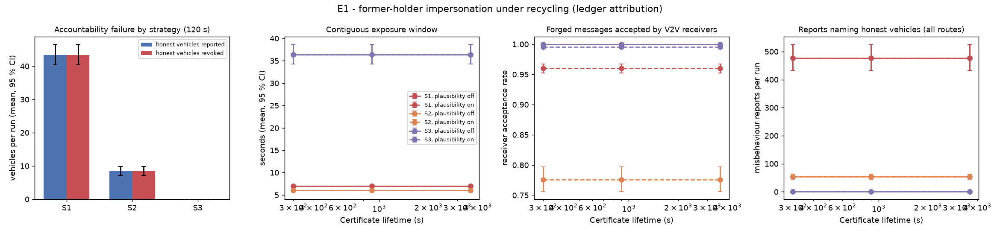
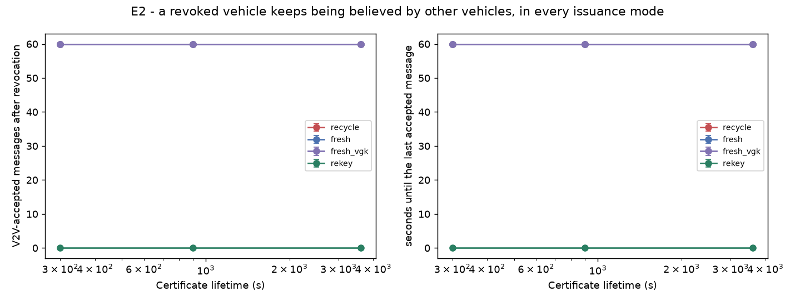
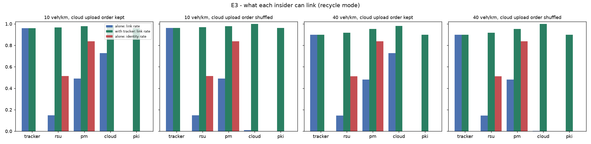
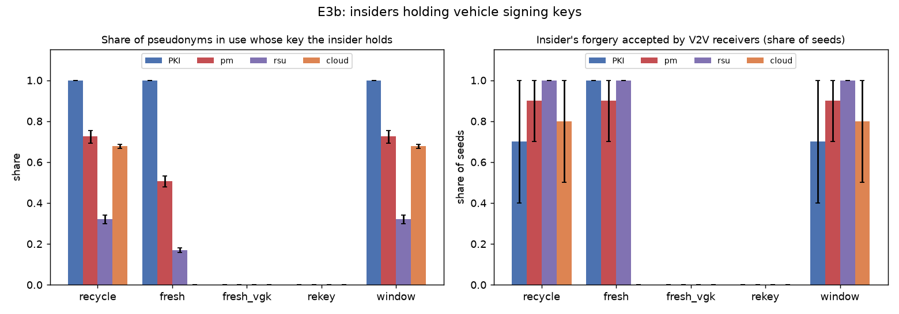
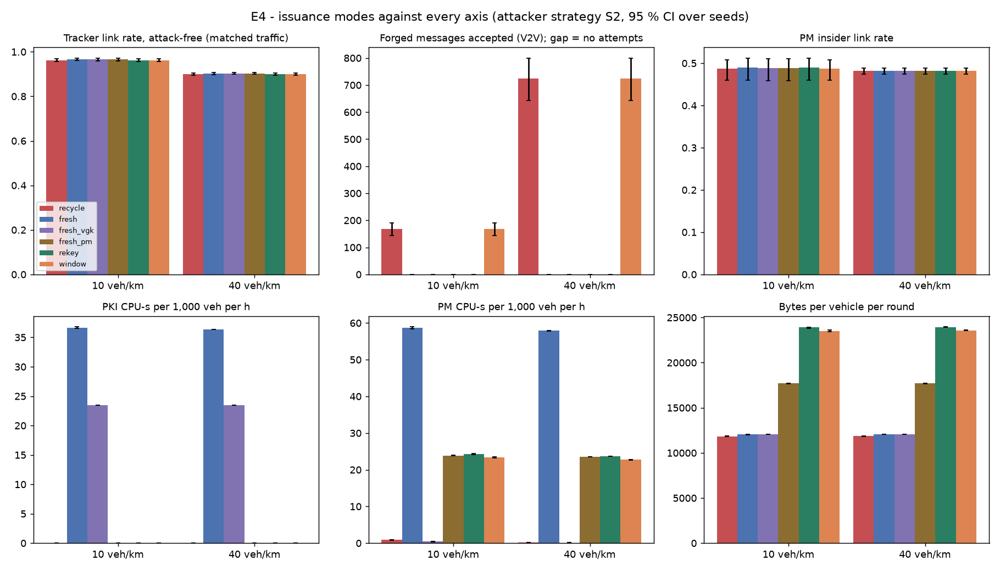
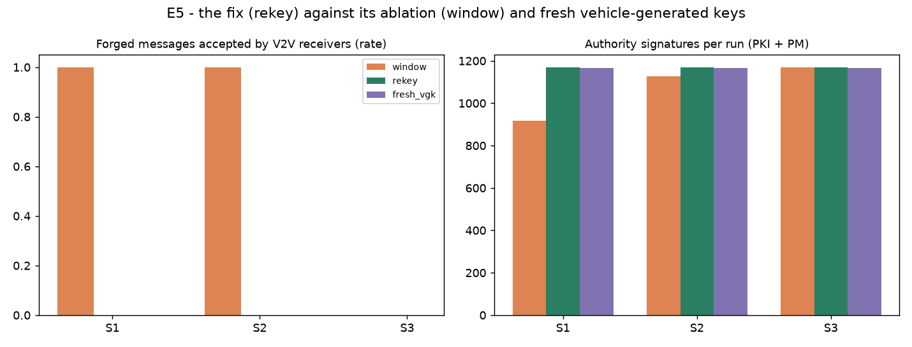
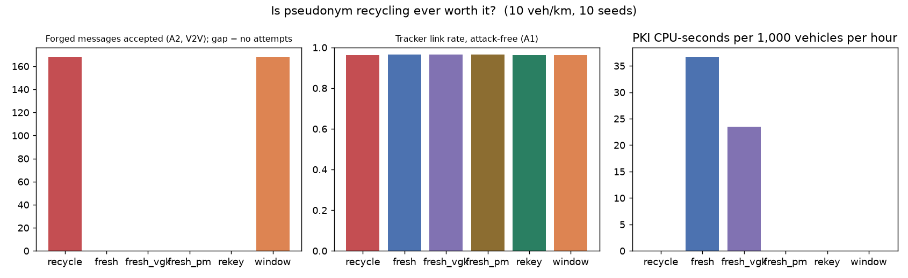
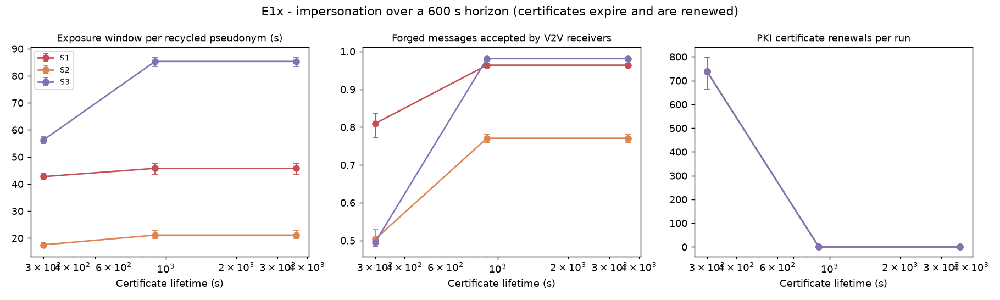
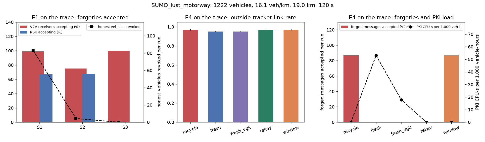
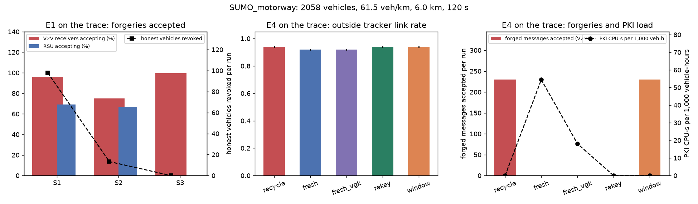

# Pseudonym recycling study: results

Back to the [README](../README.md). Design, pre-registered outcome cases and the
scope after the external review in [recycling.md](recycling.md); the response to each
review item in [review_response.md](review_response.md). All numbers below come from
`results/recycling/*.json`, produced by `pop-sim recycling` at version 3.5.0 with ten
seeds per cell and four rounds of 30 s (two PMs, six RSUs, 5 km ring road, three
pseudonyms per vehicle, 3 s silence after each change, 3 m GPS noise, ledger
attribution, vehicle-to-vehicle receivers within 300 m). Every cell is the mean over
seeds with a 95 % bootstrap confidence interval. E2 (and the misbehaver half of E1r)
runs under oracle attribution, which tells the RSU the true sender; it is marked there.

What changed against 3.4.0 (the review, items R01 to R25, is answered item by item in
[review_response.md](review_response.md)):

* **Population counts are disjoint.** "Honest vehicles revoked" now counts honest
  vehicles only; attackers revoked are a separate column, and every per-seed record
  carries `vehicles = honest + attackers` and `revoked_total = revoked_honest +
  revoked_attackers` (R01). In 3.4.0 the column included revoked attackers.
* **A ratio with nothing to divide is "not applicable"**, not 0 % or 100 % (R02). A
  mode in which no forgery can be attempted has no acceptance rate, and the paired
  tests on it are reported as not applicable rather than as p = 0.002.
* **Receivers recheck time on every message (R03), and a retained credential is a
  frozen copy (R04).** In 3.4.0 the copy a former holder kept was the live object,
  so it was renewed along with the holder's; that is why certificate expiry "changed
  nothing" in E1x. It now does (below).
* **The eavesdropper hears forged messages too (R14)**, and privacy is reported both
  attack-free on matched traffic (R13) and with the forgeries on the air, with a
  pre-set equivalence margin and test (R12).
* **Every result file carries per-seed numerators and denominators** (R16):
  opportunities, messages sent, receiver checks, reports and distinct vehicles are
  separate fields, and pooled percentiles are pooled, not averaged.
* **E3 reports cluster purity, pair recall and identity attribution per driven
  second** (R15), not only "identity rate"; the cloud row is "no channel" where a
  mode uploads nothing (R23).
* **CPU costs are measured on the machine that ran the study** and shown with a
  ×0.5 to ×2 range (R17); message sizes are given from a standards-based CAM model
  besides the simulator's count (R18).
* **SUMO attackers are drawn from the vehicles inside the 120 s window**, the
  departed-vehicle return policy is a parameter, and the motorway is run over five
  traffic realizations (R21, R22).

## E1. A former holder can impersonate the new holder (RQ1)

Five percent of vehicles keep the private key and the certificate of every pseudonym
they held and sign under those pseudonyms after recycling. Ten vehicles per km,
about 92 honest vehicles and 5 attackers per run.

| Strategy | Receivers that accept the forgery (plausibility off / on) | RSU accepts | Exposure window per pseudonym (mean, pooled p95) | Reports naming the innocent holder (distinct vehicles) | Honest vehicles revoked per run | Attackers revoked |
|---|---|---|---|---|---|---|
| S1 remote shadow | 100 % / 96.5 % | 70 % | 32.6 s, 63 s | 223 (14) | 31.8 of 91.5 (35 %) | 1.4 of 5 |
| S2 co-located ghost | 100 % / 77.1 % | 65 % | 14.0 s, 33 s | 38 (6) | 6.0 (6.9 %) | 0.1 |
| S3 gap filler | 100 % / 99.5 % | 0 % | 37.8 s, 60 s | 0 | 0 | 0 |

* Vehicle-to-vehicle receivers accept every forgery: they check the certificate and
  the signature, and the former holder has both. The local plausibility rule removes
  3.5 % of S1 and 23 % of S2 acceptances, those at receivers that also heard the real
  holder; S3 is untouched because nobody else is using the pseudonym.
* The RSU, which has the ledger, still accepts 65 to 70 % of S1 and S2 forgeries:
  the forger's first message under a pseudonym sets the ledger's last-seen position,
  and from then on the *real* holder is the one that looks cloned.
* That is the accountability failure. Under ledger attribution the RSU reports the
  current holder for every clone it detects. S1's forged messages name 14 distinct
  innocent vehicles per run (223 reports); about as many again are reported for
  their *own* messages, which now look like clones of the forger's, and the
  first-report rule revokes 31.8 honest vehicles per run, 35 % of the honest
  population, in two minutes; 1.4 of the 5 attackers are revoked as well. E1r below
  varies the rule.
* Certificate lifetime (300, 900, 3600 s) does not change any of this within 120 s,
  because no certificate expires inside it; E1x below runs 600 s.
* Density from 2 to 80 vehicles per km leaves the rates where they are (receivers
  96.5 to 97.4 % for S1, 74 to 84 % for S2, 99.5 % or more for S3) and the share of
  honest vehicles revoked by S1 at 35 to 36 % (48 % at 2 vehicles per km). The
  attacker share drives it: 1 %, 5 % and 10 % former holders revoke 9 %, 35 % and
  58 % of the honest vehicles under S1, and 1 %, 7 % and 13 % under S2.

## E1r. A stricter revocation rule delays the wrongful revocations, it does not prevent them

*Being rerun at 3.5.0. The 3.4.0 figures for this section counted revoked
attackers among the honest vehicles (R01) and are withdrawn; the new table will
replace this note.*

## E2. Revocation does not reach other vehicles (RQ2)

One vehicle replays the pseudonyms it has already used. The first replay is only
possible in round 2, so the RSU catches it there and it is revoked after round 2, 60 s
into the 120 s run. It keeps transmitting from the copies it kept. For every lifetime
tested, other vehicles accept all 60 of its later messages for the remaining 60 s of
the run: revocation lives in the ledger and the CRL, which V2V receivers never
consult. Within 120 s no certificate expires; over 600 s (E2x below) the revoked
vehicle is believed until its certificates expire, so certificate lifetime is the
only bound.

E2 is run under *oracle* attribution (the RSU is told the true sender), unlike the
rest of the page, so that the misbehaving vehicle itself is the one revoked. Under
ledger attribution its replay would be attributed to the pseudonym's current holder,
which is the E1 and E6 failure.

## E3. What each insider can link (RQ3)

Recycle mode, ten seeds, ten and forty vehicles per km. *Link rate* is the share of
a vehicle's pseudonym changes the entity joins correctly and *precision* the share of
its proposed joins that are correct. *Pair recall* is the share of same-vehicle
pseudonym pairs that end up in one cluster and *purity* the share of a cluster's
pseudonyms that belong to its majority vehicle. *Identity rate* is the share of
vehicles whose cluster carries a permanent identity. The last two columns split each
vehicle's driven seconds: attributed to its own identity, or to a cluster that
carries more than one identity (ambiguous). An entity that proposes no joins has no
precision (n/a).

| Entity | Link rate (10 / 40) | Precision | Pair recall | Purity | Identity rate | Seconds attributed to the right identity | Ambiguous seconds |
|---|---|---|---|---|---|---|---|
| Outside tracker (A1) | 0.96 / 0.90 | 0.92 / 0.73 | 0.55 / 0.44 | 0.94 / 0.81 | 0 | 0 | 0 |
| One RSU | 0.15 | 1.00 | 0.06 | 1.00 | 0.51 | 0.17 | 0 |
| One PM | 0.49 / 0.48 | 1.00 | 0.38 / 0.36 | 1.00 | 0.84 | 0.51 / 0.50 | 0 |
| Cloud, upload order kept | 0.73 | 1.00 | 0.11 | 1.00 | 0 | 0 | 0 |
| Cloud, order shuffled before upload | 0.009 / 0.002 | 0.01 | 0.001 | 0.34 | 0 | 0 | 0 |
| PKI | 0 | n/a | 0 | 1.00 | 0 | 0 | 0 |
| Tracker + one PM (A4) | 0.98 / 0.95 | 0.80 / 0.21 | 0.74 / 0.68 | 0.91 / 0.67 | 0.84 | 0.61 / 0.38 | 0.11 / 0.33 |
| Tracker + cloud (order kept) | 0.99 / 0.98 | 0.78 / 0.16 | 0.59 / 0.57 | 0.89 / 0.60 | 0 | 0 | 0 |
| All of them (order kept) | 0.99 / 0.99 | 0.74 / 0.11 | 0.77 / 0.75 | 0.87 / 0.57 | 0.84 | 0.59 / 0.33 | 0.15 / 0.44 |

* A single PM names the owner of 84 % of the vehicles in its domain, by construction
  of the ledger, and attributes half of every vehicle's driven seconds to the right
  identity. The ledger, not the recycling, creates this exposure: the PM's link rate
  is the same in every issuance mode (E4).
* Adding the outside tracker helps at low density and hurts at high density. At 10
  vehicles per km the tracker plus one PM attribute 61 % of driven seconds to the
  right identity (11 % ambiguous). At 40 vehicles per km the tracker's wrong links
  merge the PM's correct clusters: purity falls to 0.67, only 38 % of seconds are
  attributed to the right identity and 33 % sit in clusters that carry several
  identities. 3.4.0 reported the coverage of the largest cluster (95 %) as if it
  were attribution; it is not.
* The cloud-order leak is real: because `RSU.collect_used` returns one vehicle's
  pseudonyms consecutively and the PM uploads in that order, the cloud links 73 % of
  changes with perfect precision before it shuffles anything. Shuffling at the PM
  before upload (`shuffle_before_upload=True`, one line) removes it (under 1 %). The
  leak exists only where pseudonyms are uploaded to the cloud (recycle, rekey,
  window); fresh issuance has no cloud channel at all (E4).
* With the order shuffled the cloud's chaining joins everything to everything: its
  combination with the tracker has a link rate of 1.0 with precision 0.01, which is
  one cluster per run, not linkage.

## E3b. Insiders hold vehicle signing keys

In PoP the private keys pass through the infrastructure in software: the PKI
generates them, each PM decrypts the PKI's package (`receive_from_pki`) and holds
its pool, each RSU holds the sets it hands out (`receive_sets`), and the cloud holds
every returned pseudonym (`PMCloud.upload`). E3b records every entity that ever holds
a pseudonym's private key. One instance of each (the PKI, the first PM, the first
RSU, the cloud) then forges 10 messages per round with keys it holds, each on
behalf of the vehicle currently holding the pseudonym, under three strategies:

* **offset**: a position 40 m from the holder;
* **near**: 10 m from the holder, inside the 25 m that receivers and RSUs allow
  between two messages of one pseudonym in the same second;
* **silent**: the holder's position, while the holder is in its post-change silent
  period and no receiver has heard the new pseudonym yet.

Ten vehicles per km, plausibility on, ledger attribution, ten seeds, four rounds.
Key shares are the share of pseudonyms in use whose current key the entity holds.

| Mode | Keys in use held: PKI / PM / RSU / cloud |
|---|---|
| recycle, window | 1.00 / 0.68 to 0.73 / 0.29 to 0.33 / 0.65 to 0.68 |
| fresh | 1.00 / 0.44 to 0.51 / 0.15 to 0.17 / 0 |
| fresh_vgk, rekey | 0 / 0 / 0 / 0 |

Outcome of each forgery (recycle; fresh and window give the same rates), range over
the entities that hold keys. Where an entity holds no key, nothing can be attempted
and the rates are not applicable rather than zero.

| Strategy | Receivers in range that accept | Forgeries accepted by at least one receiver | RSU accepts | RSU reports the innocent holder |
|---|---|---|---|---|
| offset (40 m) | 0.34 to 0.36 | 0.64 to 0.70 | 0.30 | 0.70 |
| near (10 m) | 1.00 | 1.00 | 1.00 | 0.00 |
| silent period | 0.99 to 1.00 | 1.00 | 1.00 | 0.00 |

* Wherever the infrastructure generates or relays keys, an honest-but-curious
  insider can sign as a vehicle. The PKI holds every key in use under recycle, fresh
  and window; one PM about two thirds of them under recycle, one RSU a third, and the
  cloud two thirds (every recycled pseudonym has passed through it). Fresh issuance
  keeps keys out of the cloud only because fresh pseudonyms are never uploaded.
* A careless insider is caught half the time: at 40 m, receivers that just heard the
  real holder reject the message as two places at once, a third of receivers accept,
  and the RSU reports the holder for 70 % of the forgeries, an innocent vehicle
  blamed for the insider's message.
* A capable insider is not caught at all. Inside the 25 m tolerance, or during the
  holder's silent period, every receiver and the RSU accept the forgery and nobody
  is reported: the forgery is indistinguishable from the holder's own message.
* With vehicle-generated keys (fresh_vgk, rekey) no infrastructure entity ever holds
  a key in use, checked over every entity's full custody record, so the column is
  zero by construction rather than by luck. `PKI.certify` takes public keys only.

## E4. Issuance modes against every axis (RQ4)

Attacker strategy S2 (5 % former holders), plausibility on, 900 s certificates, ten
paired seeds, ten and forty vehicles per km. Privacy is measured twice: attack-free
(the same traffic with no former holders), and with the former holders' forged
messages on the air, which the eavesdropper hears like any other message. "n/a" marks
a rate with no attempts behind it.

| Axis | recycle | fresh | fresh_vgk | rekey | window |
|---|---|---|---|---|---|
| Tracker link rate, attack-free, 10 / 40 veh/km | 0.962 / 0.900 | 0.966 / 0.902 | 0.965 / 0.903 | 0.962 / 0.900 | 0.962 / 0.900 |
| Tracker link rate, forgeries on the air, 10 / 40 | 0.957 / 0.880 | 0.966 / 0.902 | 0.965 / 0.903 | 0.957 / 0.882 | 0.957 / 0.880 |
| Forged messages sent / accepted by receivers, 10 veh/km | 104 / 104 | no holder to impersonate | no holder to impersonate | 117 / 0 | 104 / 104 |
| Forged messages sent / accepted, 40 veh/km | 502 / 502 | no holder to impersonate | no holder to impersonate | 440 / 0 | 502 / 502 |
| Honest vehicles revoked, 10 / 40 | 6.0 / 27.0 | 0 | 0 | 0 | 6.0 / 27.0 |
| PM insider link rate | 0.49 | 0.49 | 0.49 | 0.49 | 0.49 |
| Cloud insider link rate (upload order kept) | 0.73 | no cloud channel | no cloud channel | 0.73 | 0.73 |
| PKI signatures per run, 10 / 40 | 0 | 1,164 / 4,697 | 1,158 / 4,688 | 0 | 0 |
| PM signatures per run, 10 / 40 | 16 | 8 | 8 | 1,170 / 4,703 | 1,141 / 4,566 |
| PKI CPU-s per 1,000 veh-h (measured costs) | 0 | 27 | 17 | 0 | 0 |
| PM CPU-s per 1,000 veh-h (measured costs) | 0.2 to 1.0 | 38 to 39 | 0.1 to 0.5 | 17 to 18 | 16 to 17 |
| Vehicle key generations per vehicle per round | 0 | 0 | 3 | 3 | 0 |
| Bytes per vehicle per round (simulator count) | 11.9 k | 12.0 k | 12.1 k | 23.9 k | 23.6 k |
| Bytes per CAM, standards model, certificate in every message | 277 | 277 | 277 | 407 (1.47×) | 407 (1.47×) |
| Bytes per CAM, certificate in 1 of 10 messages, digest otherwise | 167 | 167 | 167 | 187 (1.12×) | 187 (1.12×) |
| Stock-outs per run, 10 / 40 | 0.9 / 0.3 | 1.3 / 0.6 | 0 | 1.5 / 0.6 | 0.9 / 0.3 |

**Costs.** The CPU figures use operation costs measured on the machine that ran the
study (`calibrate_op_costs`: ECDSA P-256 sign about 0.04 to 0.07 ms, verify 0.1 to
0.13 ms, key generation 0.03 ms, ECIES-style encryption and decryption about 0.1 ms
each, `cryptography` 49.0.0, Python 3.11). They are recorded in each result file
with the ×0.5 to ×2 range (`cpu_range_x0.5_x2_per_1000_veh_h`), and they are a
software estimate, not an HSM's. The ratios between modes do not depend on the
machine: fresh issuance puts about 1,160 signatures per run (ten vehicles per km) on
the PKI and the decryption of every package on the PMs; fresh_vgk drops the PKI's
key generation and encryption and the PMs' decryption; rekey and window move the
signatures to the PMs. 3.4.0 reported 54 CPU-s for fresh issuance from assumed
costs and without encryption; the measured figure is 27 at the PKI plus 38 at the
PMs.

**Sizes.** The simulator counts the holder certificate in full on every message, so
rekey and window come out at twice the bytes. The standards model (`v2/sizes.py`:
typical COER sizes for an IEEE 1609.2 / ETSI TS 103 097 secured CAM; not a byte-exact
encoder) gives 1.47× with the full certificate in every message and 1.12× when the
certificate rides in one message in ten and a digest in the rest, as deployments do.
3.4.0's "twice the bytes" is the upper bound, not the expected cost.

**Tests** (paired over ten seeds with the same traffic in every mode; exact two-sided
Wilcoxon signed-rank p from the 1,024 sign patterns; equivalence by two one-sided
tests on the paired differences with a margin of ±1 point of link rate):

* Forged acceptances, recycle against rekey: p = 0.002, all ten pairs one way, at
  both densities. Against fresh and fresh_vgk the test is not applicable: no
  impersonation attempt exists in those modes (see case 2 below).
* PKI load, recycle against fresh and fresh_vgk: p = 0.002.
* Privacy, attack-free: recycle is 0.34 points less linkable than fresh at 10
  vehicles per km (95 % CI 0.20 to 0.48, p = 0.004) and 0.29 at 40 (p = 0.002), and
  the two are equivalent within ±1 point (TOST p = 0.001 at both densities). The
  small gap comes from relabel captures: a recycled label that reappears near its
  former holder's coasting track is taken for a continuation of it (1.7 captures per
  run at 10 vehicles per km, 5.2 at 40; rekey and window keep recycled labels and
  have the same, fresh issuance never does).
* Privacy, forgeries on the air: recycle is 0.86 points less linkable than fresh at
  10 vehicles per km and 2.2 points at 40 (p = 0.002), not equivalent within ±1
  point. The forged messages carry recycled labels at other vehicles' positions and
  confuse the tracker (14.9 and 59 captures per run). This is a side effect of the
  attack, not a privacy property of recycling.

Reading it against the pre-registered cases:

1. **A1 linkability is equivalent across modes** without attackers, within ±1 point.
   Recycling buys no privacy against an eavesdropper worth the name.
2. **A2 impersonation is possible only under recycle and window**, and accepted
   only there. Rekey leaves the former holder an old key that every receiver now
   rejects. Under fresh and fresh_vgk the former holder's retained credentials are
   still valid (in every mode the five former holders hold 40 unexpired credentials
   at the end of the run), but none of them is held by another vehicle, so there is
   nobody to impersonate or get revoked. Signing with them is reuse of the vehicle's
   own retired pseudonyms, which receivers accept until expiry (the E2 mechanism);
   it is a separate endpoint and is not counted here as impersonation.
3. **The PKI load of fresh issuance is 27 CPU-seconds per 1,000 vehicles per hour on
   this machine** (17 with vehicle-generated keys; 14 to 54 and 8 to 33 over the
   ×0.5 to ×2 range), against the pre-registered threshold of one. The literal
   threshold of case 1 is not met: at 30 s rounds with three pseudonyms per vehicle,
   fresh issuance is 360 certificates per vehicle-hour. Recycling's steady-state PKI
   cost inside the horizon is zero because no certificate came up for renewal; at
   the lifetime scale it is one signature per circulating pseudonym per lifetime,
   about four per vehicle-hour for 3,600 s certificates, roughly a hundredth of fresh
   issuance.
4. **Safe recycling is fresh issuance with the signing moved to the PMs.** `rekey`
   costs the PMs 17 to 18 CPU-s per 1,000 vehicle-hours, about fresh_vgk's PKI cost,
   the same three key generations per vehicle per round, and 1.12 to 1.47 times the
   bytes per message (the holder certificate rides along). The pseudonym label it
   keeps adds nothing measurable.

So the outcome is case 2 with case 3 as the headline: recycling earns its place only
as a load shift, and in exchange it breaks accountability (E1: the ledger blames the
victim) and makes revocation unenforceable at vehicles (E2).

## E5. The fix and its ablation (RQ4)

Ten vehicles per km, 900 s certificates, plausibility off (the receiver's weakest
setting), ten seeds. `window` binds the recycled pseudonym to a holder window but
keeps the shared key; `rekey` also gives each holder a fresh key; `fresh_vgk` issues
fresh pseudonyms with vehicle-generated keys.

| Variant | S1 forgeries sent / accepted | S2 sent / accepted | S3 sent / accepted | Honest vehicles revoked (S1 / S2) | PM signatures per run | Vehicle key generations per vehicle per round | Bytes per vehicle per round (simulator) |
|---|---|---|---|---|---|---|---|
| window | 739 / 739 | 104 / 104 | 471 / 0 | 31.8 / 6.0 | 990 to 1,170 | 0 | 22 to 24 k |
| rekey | 926 / 0 | 117 / 0 | 471 / 0 | 0 / 0 | 1,170 | 3 | 24 k |
| fresh_vgk | no holder to impersonate | no holder to impersonate | no holder to impersonate | 0 / 0 | 8 (PKI 1,158) | 3 | 12 k |

* The window alone stops only the gap filler (S3): a former holder cannot present a
  certificate for a time when it did not hold the pseudonym. It stops nothing else,
  because the current holder's window certificate is public (it rides in every
  message) and the former holder still has the key it binds.
* Re-keying stops all three strategies at every seed, and with it the wrongful
  revocations: zero honest vehicles revoked.
* Its cost against fresh vehicle-generated keys: the same three key generations per
  vehicle per round, the same number of signatures (moved from the PKI to the PMs),
  and 1.12 to 1.47 times the bytes per message in the standards model (twice in the
  simulator's count, which sends the full certificate every time). Nothing is left
  that the recycled label buys.

## E6. The attack bench under ledger attribution

The eighteen attacks of `pop-sim attacks` rerun with `attribution="ledger"` instead
of the oracle attribution v2.2.1 used. One outcome changes: *revoked vehicle keeps
transmitting* goes from defended to vulnerable. Under ledger attribution the
malicious vehicle's replay is attributed to the pseudonym's current holder, so the
honest holder is revoked and the attacker is not; it then keeps its pseudonyms and
keeps transmitting. The other seventeen outcomes are unchanged (13 defended, 4
mitigated). The bench's default stays oracle so that the v2.2.1 numbers remain
reproducible, and this finding is reported here rather than hidden by the default.

One of the unchanged outcomes needs a word, or it reads as a contradiction of E1. The
bench's *pseudonym replay* attack stays defended under ledger attribution only because
the replay is caught while the attacker still holds the pseudonym: the ledger's holder
*is* the attacker, so the report names the right vehicle. The replay that matters
under recycling is the one made after the pseudonym has moved to someone else, and
that is what E1 measures: there the ledger's holder is the victim, and the report
names the victim.

## The answer

The pre-registered outcome is case 2 with case 3 as the headline (the cases are
defined in [recycling.md](recycling.md)): recycling wins on one axis, authority load,
ties on privacy, and costs two properties the manuscript promises:

* **Privacy against an eavesdropper**: equivalent to fresh issuance within ±1 point
  of link rate without attackers, on the ring, on both SUMO traces and over five
  motorway traffic realizations (E4). With forgeries on the air recycle comes out a
  point or two *less* linkable, because the forgeries confuse the tracker; that is a
  side effect of the attack, not a design property.
* **Security**: a former holder forges accepted messages under every strategy (E1),
  and the ledger-based accountability turns those forgeries into revocations of
  innocent vehicles, 35 % of the honest vehicles in two minutes under S1 at 5 %
  attackers (E1, E6); a stricter revocation rule only delays them (E1r). Under
  fresh issuance a retained credential belongs to nobody else, so there is no one
  to impersonate or frame. Both hold on real SUMO traces.
* **Revocation**: unenforceable at vehicles until the certificates expire (E2, E2x),
  which is a property of certificate lifetime, not of recycling; recycling makes the
  key a shared secret, so the damage spreads to every past holder.
* **Authority load**: the only axis recycling wins. Fresh issuance costs the PKI 27
  CPU-seconds per 1,000 vehicle-hours on the machine measured, plus the PMs' package
  decryption (17 at the PKI and almost nothing at the PMs with vehicle-generated
  keys); recycling costs it a signature per circulating pseudonym per certificate
  lifetime. If that load matters, the safe form of recycling (`rekey`) delivers it
  by making the PMs do the signing, at which point it is fresh issuance by another
  authority with a 12 to 47 % larger message.
* **Insider exposure**: linking is the same in every mode (the ledger, not the
  recycling, lets a PM name 84 % of its vehicles and attribute half of their driving
  to them, and the cloud's upload order leaks 73 % of the pseudonym changes until the
  PM shuffles before uploading, E3). Forging is not: under recycle, fresh and window
  the PKI, PMs, RSUs and (under recycle) the cloud hold vehicle signing keys and can
  sign as any vehicle; claiming a position within 25 m of the holder, or forging
  during its silent period, no receiver or RSU notices (E3b). Only vehicle-generated
  keys (fresh_vgk, rekey) remove that.

## E1x and E2x. The longer horizon: certificates expire

`pop-sim recycling --long` reruns E1 (plausibility on, 5 % attackers, 10 veh/km) and
E2 over 600 s, twenty rounds, so that 300 s certificates expire and are renewed
inside the run (739 PKI renewals per run at that lifetime; none at 900 or 3,600 s).

| Strategy | Receivers accepting the forgery, lifetime 300 / 900 / 3,600 s | Exposure window, mean / pooled p95 (300 s; 900 and 3,600 s) | Honest vehicles revoked (of 91.5) | Attackers revoked (of 5) |
|---|---|---|---|---|
| S1 remote shadow | 80.9 % / 96.4 % / 96.4 % | 43 s / 84 s; 46 s / 105 s | 89.6 (98 %) | 4.0 |
| S2 co-located ghost | 50.3 % / 77.1 % / 77.1 % | 18 s / 42 s; 21 s / 48 s | 64.3 (71 %) | 3.0 |
| S3 gap filler | 49.5 % / 98.1 % / 98.1 % | 56 s / 120 s; 85 s / 180 s | 0 | 0 |

A revoked vehicle is believed by other vehicles until its certificates expire: for
the remaining 540 s at 900 and 3,600 s, and for 240 s at 300 s (E2x).

Version 3.4.0 reported that the lifetime axis was flat over 600 s. That was the R04
defect: the copy a former holder kept was the live pseudonym object, so when the
current holder's certificate was renewed the former holder's copy was renewed with
it. With the retained copy frozen at the time of hand-over, a 300 s lifetime cuts
the acceptance of S1's forgeries from 96 to 81 % and of S2's and S3's by about half:
receivers reject the expired certificate the former holder still presents (4,200 to
74,000 expired-certificate rejections per run).

Two things do not change. The RSU's ledger check does not look at the certificate,
so the wrongful reports and the revocations are the same at every lifetime: over 600 s
S1 gets 98 % of the honest vehicles revoked, and ledger-based accountability under
recycling collapses rather than degrades. And the renewed certificate is public (it
rides in every message of the current holder) while the key it certifies is the one
the former holder still has, so a former holder that copies the renewed certificate
off the air is re-armed at every renewal. That attacker is not simulated here (it is
one of the attacker-model extensions listed under the review scope in
[recycling.md](recycling.md)); the 300 s column is therefore a lower bound on what a
short lifetime leaves the attacker, not a mitigation. The only renewal that ends a
former holder's access is one bound to a key the former holder does not have, which
is the `rekey` design of E5.

## E1 and E4 on SUMO traces

`pop-sim recycling-sumo` reruns the E1 core cell (plausibility on, 900 s certificates,
5 % of the vehicles in the 120 s window are former holders) and E4 (all modes, S2,
paired over ten seeds, attack-free and with forgeries) on floating-car traces from
Eclipse SUMO 1.28.0, mapped onto the corridor described in
[recycling.md](recycling.md). The trace fixes the traffic; the seeds vary the keys,
which vehicles are former holders, and the GPS noise. Per-vehicle loads are
normalised by the vehicles on the corridor each second.

| Scenario | Corridor | Vehicles seen in the 120 s window (present per second) | Density in the window (whole trace) | Mean speed |
|---|---|---|---|---|
| LuST motorway (Luxembourg, 08:00, Codeca et al.) | 19.0 km, one carriageway, 33 edges, 3 to 4 lanes | 439 (283) | 14.9 veh/km (16.1) | 31.1 m/s |
| netgenerate motorway, 3,400 veh/h per direction | 6.0 km, two carriageways on one axis | 584 (372) | 62.1 veh/km of corridor (61.5) | 30.7 m/s |

The attackers are drawn from the vehicles inside the window: 22 on LuST and 29 on the
motorway. Version 3.4.0 drew 5 % of every vehicle in the trace (61 and 103), most of
which never drove inside the simulated two minutes. The achieved, time-weighted attack share (attacker
vehicle-seconds over all vehicle-seconds) is 5.2 % on LuST and 5.0 % on the motorway.

E1:

| Scenario, strategy | Receivers accepting the forgery | RSU accepting | Exposure window, mean / pooled p95 | Reports naming the innocent holder (distinct) | Honest vehicles revoked in 120 s (of those seen in the window) |
|---|---|---|---|---|---|
| LuST, S1 remote shadow | 98.7 % | 67 % | 28 s / 63 s | 548 (32) | 76.7 of 417 (18 %) |
| LuST, S2 co-located ghost | 75.7 % | 64 % | 18 s / 21 s | 24 (3.5) | 3.2 |
| LuST, S3 gap filler | 100 % | 0 % | 31 s / 60 s | 0 | 0 |
| Motorway, S1 | 96.2 % | 69 % | 26 s / 56 s | 601 (44) | 98.4 of 555 (18 %) |
| Motorway, S2 | 79.0 % | 71 % | 10 s / 21 s | 73 (14) | 12.8 |
| Motorway, S3 | 99.6 % | 0 % | 29 s / 60 s | 0 | 0 |

E4:

| Scenario, mode | Tracker link rate, attack-free / forgeries on the air | Forged messages accepted | Honest vehicles revoked | PKI CPU-s per 1,000 veh-h | PM CPU-s per 1,000 veh-h | Bytes per vehicle per round (simulator) | Allotment stock-outs per run |
|---|---|---|---|---|---|---|---|
| LuST, recycle | 0.949 / 0.947 | 68 | 3.2 | 0 | 0.3 | 10.7 k | 3 |
| LuST, fresh | 0.950 / 0.950 | no holder to impersonate | 0 | 22 | 30 | 10.8 k | 2 |
| LuST, fresh_vgk | 0.951 / 0.951 | no holder to impersonate | 0 | 15 | 0.1 | 10.8 k | 0 |
| LuST, rekey | 0.949 / 0.946 | 0 | 0 | 0 | 15 | 21.7 k | 3 |
| LuST, window | 0.949 / 0.947 | 68 | 3.2 | 0 | 15 | 21.7 k | 3 |
| Motorway, recycle | 0.916 / 0.906 | 255 | 12.8 | 0 | 0.2 | 10.5 k | 2.6 |
| Motorway, fresh | 0.920 / 0.920 | no holder to impersonate | 0 | 21 | 28 | 10.6 k | 2 |
| Motorway, fresh_vgk | 0.920 / 0.920 | no holder to impersonate | 0 | 14 | 0.1 | 10.6 k | 0 |
| Motorway, rekey | 0.916 / 0.907 | 0 | 0 | 0 | 14 | 21.5 k | 4 |
| Motorway, window | 0.916 / 0.906 | 255 | 12.8 | 0 | 14 | 21.3 k | 2.6 |

* The picture is the ring's. Receivers accept 96 to 100 % of S1 and S3 forgeries and
  76 to 79 % of S2's; the RSU accepts two thirds of S1 and S2; the ledger names
  innocent holders hundreds of times per run, and S1 gets 18 % of the honest vehicles
  seen in the window revoked in two minutes. Fresh, fresh_vgk and rekey have zero
  accepted forgeries and zero wrongful revocations on both traces.
* Attack-free, recycle and fresh are equivalent within ±1 point on both traces (LuST
  0.16 points, motorway 0.32 points in fresh's favour; TOST p = 0.001). With
  forgeries on the air the motorway gap grows to 1.4 points, as on the ring.
* The per-vehicle PKI cost of fresh issuance is in the ring's range (these runs
  calibrated their own costs: 21 to 22 CPU-s, 14 to 15 with vehicle-generated keys);
  `rekey` moves about 15 CPU-s to the PMs.

**Departed vehicles.** A vehicle that leaves the corridor holds unused pseudonyms.
The default returns them through its last RSU at once (as it would to the next RSU
it meets); `pop-sim recycling-sumo --returns` varies that on the motorway (five
seeds, attack-free):

| Return policy | recycle: stock-outs per run / pseudonyms lost / tracker link rate | fresh_vgk: stock-outs / link rate |
|---|---|---|
| All returned at once (default) | 4 / 0 / 0.918 | 0 / 0.921 |
| All returned two rounds later | 282 / 0 / 0.907 | 0 / 0.921 |
| Half returned at once, half lost | 202 / 318 / 0.914 | 0 / 0.921 |
| None returned | 107 / 529 / 0.905 | 0 / 0.921 |

Recycling depends on the departed vehicles' pseudonyms coming back promptly: any
policy short of immediate return leaves 100 to 280 allotment requests per run
unserved (the tracker's link rate moves by up to 1.3 points with it). Fresh issuance
is unaffected.

**Traffic realizations.** `--trace` with five motorway traces regenerated with SUMO
`--seed` 1 to 5 (588 to 607 vehicles in the window, 61.5 to 62.6 vehicles per km;
two key seeds each):

* S2 receiver acceptance 0.75 (0.73 to 0.79 over the five realizations), honest
  vehicles revoked 16.4 per run (14.5 to 18.1).
* Attack-free tracker link rate: recycle 0.915 (0.908 to 0.922), fresh 0.917,
  fresh_vgk 0.918. Recycle is 0.04 to 0.44 points less linkable than fresh in every
  realization; the realization moves the link rate by two points, the issuance mode
  by under half a point.

## Limitations

The scope after the external review, including the attacker-model extensions that
were not made, is set out in [recycling.md](recycling.md#scope-after-the-external-review-of-v340-version-350).
In short:

* E1 to E6 use 120 s horizons, inside which no certificate expires; E1x and E2x
  (600 s) cover expiry and renewal.
* One attacker model per run, with a fixed strategy. The former holder does not copy
  renewed certificates off the air, does not adapt to detection, and does not mix
  strategies; the 300 s results of E1x are a lower bound for that reason.
* Ring road without intersections (the tracker's easiest case) and a tracker that is
  strong but not optimal; both bias the privacy numbers in the same direction for
  every mode, so the mode comparison stands.
* Two SUMO scenarios, both motorways, plus five realizations of one of them. No urban
  scenario: the road model is one-dimensional, so a corridor through intersections
  would discard the turning traffic.
* The detection side has options (local history at each RSU, continuous report
  processing with delay, message loss, a kinematic detector) whose defaults reproduce
  the runs above; they are exercised by the tests, not swept in the study.
* CPU costs are software measurements on one machine, not HSM figures; message sizes
  come from a standards-based model, not a byte-exact encoder.
