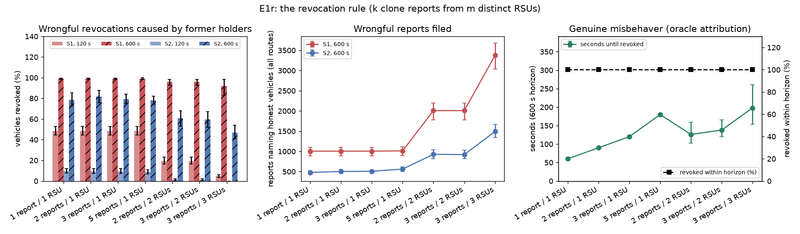
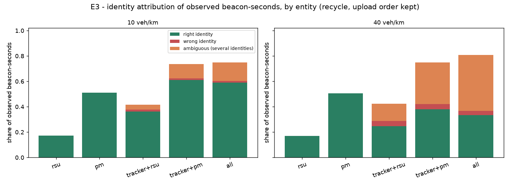

# Pseudonym recycling study: results

Back to the [README](../README.md). Design, pre-registered outcome cases and the
scope of the model in [recycling.md](recycling.md); the responses to the two external
reviews in [review_response.md](review_response.md) (v3.4.0, R01 to R25) and
[review_response_round2.md](review_response_round2.md) (v3.5.0, G01 to G10). All
numbers below come from `results/recycling/*.json`, produced by `pop-sim recycling`
at version 3.6.0 with ten seeds per cell and four rounds of 30 s (two PMs, six RSUs,
5 km ring road, three pseudonyms per vehicle, 3 s silence after each change, 3 m
observer noise, ledger attribution, vehicle-to-vehicle receivers within 300 m). Every
cell is the mean over seeds with a 95 % bootstrap confidence interval; every result
file carries its per-seed records, the source commit it was produced from and the
measured cost coefficients. E2 (and the misbehaver half of E1r) runs under oracle
attribution, which tells the RSU the true sender; it is marked there.

**What every attack rate below means.** The former holder's strategies are
conditioned on simulator state: S1 and S2 act only while the ledger names another
vehicle as the pseudonym's holder and that holder is transmitting (S2 also reads the
holder's position), S3 only while the ledger names nobody. The rates are therefore
conditional model results, not feasible attack rates and not formal upper bounds; a
former holder that broadcasts its keys blind, or decides from what it hears, has a
different schedule and is not modelled. The former holder also stops once it is
itself revoked. See [recycling.md](recycling.md#scope-after-the-external-review-of-v340-version-350).

What changed against 3.5.0 (the follow-up review, G01 to G10):

* **Every misbehaviour report is counted (G01).** Reports pass through one point and
  carry the route that raised them: a forged message, or a vehicle's own beacon (an
  honest holder whose pseudonym a forgery has made look cloned). Both are counted,
  naming honest vehicles only, and their union is the "honest vehicles reported"
  column. 3.5.0 counted only the first route and labelled it "innocent" without
  checking that the named vehicle was honest.
* **Attackers keep every credential they held (G02).** 3.5.0 dropped the last
  credential of each round, about a third of them. Every former-holder result is
  larger for it: S1 now revokes 48 % of honest vehicles in two minutes, not 35 %.
* **Exposure is per contiguous window and per holding (G03)**, with windows that
  reach the end of the run marked censored. 3.5.0 summed separated episodes.
* **Holder windows no longer overlap (G04).** The outgoing holder owns the handoff
  instant (its last message falls on it); the incoming holder is valid from the
  next instant.
* **Equivalence is a paired t TOST on the mean difference (G06)**, with its 90 %
  interval; the signed-rank test is kept only as a test of difference.
* **Identity attribution is a share of observed beacon-seconds (G07)**; a share of
  driven time sits beside it.
* **Opportunities come in three tiers (G08)**: key checks, valid-key seconds and
  eligible seconds.
* **CPU is broken down by operation and entity (G10).** The PMs' cost under fresh
  issuance is certificate verification, not decryption.
* **E2 runs under every issuance mode**, and SUMO revocation shares are over the
  vehicles that drove in the evaluated window.

## E1. A former holder can impersonate the new holder (RQ1)

Five percent of vehicles keep the private key and the certificate of every pseudonym
they held, and sign under those pseudonyms after recycling. Ten vehicles per km,
91.5 honest vehicles and 5 attackers per run, 900 s certificates. The five attackers
hold 56 to 60 distinct credentials per run and keep all of them.

| Strategy | Eligible seconds / forgeries sent | Receivers that accept (plausibility off / on) | RSU accepts | Contiguous exposure window, mean / pooled p95 | Reports naming honest vehicles: by forged messages + by their own beacons | Honest vehicles reported = revoked | Attackers revoked |
|---|---|---|---|---|---|---|---|
| S1 remote shadow | 1,006 / 1,006 | 100 % / 96.0 % | 70 % | 7.0 s / 7 s (cumulative per holding 21 s) | 294 + 183 = 477 | 43.4 of 91.5 (48 %) | 1.5 of 5 |
| S2 co-located ghost | 1,420 / 169 | 100 % / 77.5 % | 67 % | 6.0 s / 7 s (12.7 s) | 54 + 0 | 8.5 (9.6 %) | 0.2 |
| S3 gap filler | 651 / 651 | 100 % / 99.6 % | 0 % | 36.8 s / 60 s (38.2 s) | 0 | 0 | 0 |

Opportunities, from the widest denominator to the narrowest (S1): 2,895 key checks
(every retained key, every second), 2,340 seconds with a key the attacker no longer
holds and whose certificate is valid, 1,006 of them eligible (another vehicle
transmitting under the pseudonym). S2 sends only when within radio range of the
holder (169 of 1,420 eligible seconds). S3's eligible seconds are those with a valid
key and nobody holding the pseudonym.

* Vehicle-to-vehicle receivers accept every forgery: they check the certificate and
  the signature, and the former holder has both. The local plausibility rule removes
  4 % of S1 and 22 % of S2 acceptances, at receivers that also heard the real holder.
* The RSU, which has the ledger, still accepts 67 to 70 % of S1 and S2 forgeries: the
  forger's message sets the ledger's last-seen position, and from then on the *real*
  holder is the one that looks cloned.
* That is the accountability failure, and both report routes show it. S1's forged
  messages name 19.7 distinct honest vehicles per run (294 reports); the honest
  holders' own beacons, now inconsistent with the forger's, name 25.5 more (183
  reports). Under the first-report rule every honest vehicle reported is revoked: 43.4
  of 91.5 in two minutes. S2's forgeries name 8.5 honest vehicles and its quieter
  schedule leaves no beacon route. 3.5.0's "14 innocent vehicles reported, 31.8
  revoked" came from counting only the forged-message route and from the credential
  the attacker dropped every round.
* S1's contiguous exposure window is exactly the holder's active slot: 7 s (a 10 s
  slot minus the 3 s silence), three slots per holding. S3's windows run between
  holders and are censored at the end of the run in 100 of 174 cases.
* Certificate lifetime (300, 900, 3600 s) does not change any of this within 120 s;
  E1x below runs 600 s.
* Density from 2 to 80 vehicles per km leaves the receiver rates where they are (S1
  96 to 97 %, S2 75 to 86 %, S3 99.5 % or more); the share of honest vehicles S1 gets
  revoked is 45 to 48 % from 10 to 80 vehicles per km and 61 % at 2. The attacker
  share drives it: 1 %, 5 % and 10 % former holders revoke 13 %, 48 % and 64 % of the
  honest vehicles under S1, and 2 %, 10 % and 18 % under S2.

## E1r. A stricter revocation rule delays the wrongful revocations, it does not prevent them

E1 revokes on the first clone report. `pop-sim recycling --sensitivity` makes the PM
wait for k reports from at least m distinct RSUs before it asks the PKI to revoke,
for seven rules, S1 and S2 at 5 % former holders, plausibility on, 900 s
certificates, ten seeds, over 120 s and 600 s. The other side of the trade is
measured on the E2 vehicle (a genuine misbehaver replaying its own pseudonyms,
oracle attribution): how long the rule lets it run before it is revoked.

| Rule (reports / distinct RSUs) | Honest vehicles revoked by S1, 120 s / 600 s | by S2, 120 s / 600 s | Reports naming honest vehicles, S1, 600 s (all routes) | Genuine misbehaver revoked after (600 s horizon) |
|---|---|---|---|---|
| 1 / 1 (E1) | 43.4 / 90.5 | 8.5 / 71.2 | 1,005 | 60 s |
| 2 / 1 | 43.4 / 90.5 | 8.3 / 74.2 | 1,005 | 90 s |
| 3 / 1 | 43.4 / 90.5 | 8.3 / 72.2 | 1,005 | 120 s |
| 5 / 1 | 43.3 / 90.7 | 7.9 / 71.3 | 1,012 | 180 s |
| 2 / 2 | 17.1 / 87.8 | 1.1 / 54.8 | 2,008 | 126 s (102 to 159) |
| 3 / 2 | 17.1 / 87.8 | 1.1 / 53.7 | 2,008 | 138 s (120 to 165) |
| 3 / 3 | 4.2 / 84.6 | 0 / 41.9 | 3,375 | 198 s (153 to 261) |

Over 600 s S1 revokes 99 % of the 91.5 honest vehicles under the first-report rule
and 92 % under the three-RSU rule; 4 of the 5 attackers are revoked as well.

* Counting reports changes nothing: a shadowed holder is reported on every forged and
  every own message, so five reports arrive in the same round as the first.
* Requiring distinct RSUs slows it down: three RSUs cut S1's wrongful revocations at
  120 s from 43.4 to 4.2. At 600 s they are back to 85 of 91.5, because the victim
  drives past more RSUs. The wrongful reports grow with the stricter rule (1,005 to
  3,375 per run): victims not yet revoked keep being reported.
* The genuine misbehaver, revoked 60 s into the run under the first-report rule, runs
  for 198 s (up to 261 s) under the three-RSU rule, and is still caught within 600 s.

Two caveats apply (scope in [recycling.md](recycling.md#scope-after-the-external-review-of-v340-version-350)):
the RSUs share one clone-check history, so a multi-RSU quorum is correlated evidence,
not independent witnesses; and reports are handled at 30 s round boundaries while
the misbehaver replays once per round and a former holder signs every second, so the
latencies mix the rule with batching and workload. The failure is in the
attribution, not in the threshold.

## E2. Revocation does not reach other vehicles (RQ2)

One vehicle replays the pseudonyms it has already used, signing with the copies it
kept. The RSU catches the first replay in round 2 and the vehicle is revoked 60 s into
the 120 s run; it keeps transmitting. Run under every issuance mode:

| Mode | Messages other vehicles accept after the revocation (120 s run; 600 s run, lifetime 300 / 900 or 3,600 s) |
|---|---|
| recycle | 60 of 60; 240 / 540 |
| fresh | 60 of 60; 240 / 540 |
| fresh_vgk | 60 of 60; 240 / 540 |
| rekey | 0; 0 / 0 |

* Revocation lives in the ledger and the CRL, which receivers never consult, so a
  revoked vehicle is believed until its certificates expire, in every mode that
  issues pseudonym certificates without a holder window, fresh issuance included.
  This is now measured in every mode rather than inferred.
* Under rekey the retained credentials carry holder certificates that expire at the
  end of their round, so nothing the revoked vehicle kept is accepted afterwards.

E2 is run under *oracle* attribution, unlike the rest of the page, so that the
misbehaving vehicle itself is the one revoked; under ledger attribution its replay
would be attributed to the pseudonym's current holder (the E1 and E6 failure).

## E3. What each insider can link (RQ3)

Recycle mode, ten seeds, ten and forty vehicles per km. *Link rate* is the share of a
vehicle's pseudonym changes the entity joins correctly and *precision* the share of
its proposed joins that are correct. *Pair recall* is the share of same-vehicle
pseudonym pairs that end up in one cluster and *purity* the share of a cluster's
beacon-seconds that belong to its majority vehicle. *Identity rate* is the share of
vehicles whose cluster carries a permanent identity. The attribution columns are
shares of **observed beacon-seconds**, pooled over all vehicles: the seconds whose
cluster carries exactly the right identity, or more than one identity (ambiguous).
The last column divides the right-identity seconds by all **driven time** instead
(every vehicle-second on the road, silent and unserved seconds included, which carry
no observation). An entity that proposes no joins has no precision (n/a).

| Entity | Link rate (10 / 40) | Precision | Pair recall | Purity | Identity rate | Right identity, share of beacon-seconds | Ambiguous, share of beacon-seconds | Right identity, share of driven time |
|---|---|---|---|---|---|---|---|---|
| Outside tracker (A1) | 0.96 / 0.90 | 0.92 / 0.73 | 0.55 / 0.44 | 0.94 / 0.81 | 0 | 0 | 0 | 0 |
| One RSU | 0.15 | 1.00 | 0.06 | 1.00 | 0.51 | 0.17 | 0 | 0.12 |
| One PM | 0.49 / 0.48 | 1.00 | 0.38 / 0.36 | 1.00 | 0.84 | 0.51 / 0.50 | 0 | 0.36 / 0.35 |
| Cloud, upload order kept | 0.73 | 1.00 | 0.11 | 1.00 | 0 | 0 | 0 | 0 |
| Cloud, order shuffled before upload | 0.009 / 0.002 | 0.01 | 0.001 | 0.34 | 0 | 0 | 0 | 0 |
| PKI | 0 | n/a | 0 | 1.00 | 0 | 0 | 0 | 0 |
| Tracker + one PM (A4) | 0.98 / 0.95 | 0.80 / 0.21 | 0.74 / 0.68 | 0.91 / 0.67 | 0.84 | 0.61 / 0.38 | 0.11 / 0.33 | 0.43 / 0.27 |
| Tracker + cloud (order kept) | 0.99 / 0.98 | 0.78 / 0.16 | 0.59 / 0.57 | 0.89 / 0.60 | 0 | 0 | 0 | 0 |
| All of them (order kept) | 0.99 / 0.99 | 0.74 / 0.11 | 0.77 / 0.75 | 0.87 / 0.57 | 0.84 | 0.59 / 0.33 | 0.15 / 0.44 | 0.41 / 0.23 |

* A single PM names the owner of 84 % of the vehicles in its domain, by construction
  of the ledger, and attributes half of the observed beacon-seconds (36 % of driven
  time) to the right identity. The ledger, not the recycling, creates this exposure:
  the PM's link rate is the same in every issuance mode (E4).
* Adding the outside tracker helps at low density and hurts at high density. At 10
  vehicles per km the tracker plus one PM attribute 61 % of beacon-seconds to the
  right identity (11 % ambiguous). At 40 the tracker's wrong links merge the PM's
  clusters: purity falls to 0.67, 38 % of beacon-seconds are attributed correctly and
  33 % sit in clusters that carry several identities.
* The cloud-order leak is real: because `RSU.collect_used` returns one vehicle's
  pseudonyms consecutively and the PM uploads in that order, the cloud links 73 % of
  changes with perfect precision. Shuffling at the PM before upload
  (`shuffle_before_upload=True`, one line) removes it (under 1 %). The leak exists
  only where pseudonyms are uploaded (recycle, rekey, window); fresh issuance has no
  cloud channel at all (E4).
* With the order shuffled the cloud's chaining joins everything to everything: its
  combination with the tracker has a link rate of 1.0 with precision 0.01, which is
  one cluster per run, not linkage.

## E3b. Insiders hold vehicle signing keys

In PoP the private keys pass through the infrastructure in software: the PKI
generates them, each PM decrypts the PKI's package (`receive_from_pki`) and holds its
pool, each RSU holds the sets it hands out (`receive_sets`), and the cloud holds every
returned pseudonym (`PMCloud.upload`). E3b records every entity that ever holds a
pseudonym's private key. One instance of each (the PKI, the first PM, the first RSU,
the cloud) then forges 10 messages per round with keys it holds, each on behalf of
the vehicle currently holding the pseudonym, under three strategies: **offset**, a
position 40 m from the holder; **near**, 10 m from it (inside the 25 m that receivers
and RSUs allow between two messages of one pseudonym in the same second); **silent**,
at the holder's position during its post-change silent period. Ten vehicles per km,
plausibility on, ledger attribution, ten seeds (per-seed records in `E3b.json`). The
four entities forge in the same run and transmit from the position they claim (a
radio wherever they want one); these are conditional model results.

| Mode | Keys in use held: PKI / PM / RSU / cloud |
|---|---|
| recycle, window | 1.00 / 0.68 to 0.73 / 0.29 to 0.33 / 0.65 to 0.68 |
| fresh | 1.00 / 0.44 to 0.51 / 0.15 to 0.17 / 0 |
| fresh_vgk, rekey | 0 / 0 / 0 / 0 |

| Strategy | Receivers in range that accept | Forgeries accepted by at least one receiver | RSU accepts | RSU reports the innocent holder |
|---|---|---|---|---|
| offset (40 m) | 0.34 to 0.36 | 0.64 to 0.70 | 0.30 | 0.70 |
| near (10 m) | 1.00 | 1.00 | 1.00 | 0.00 |
| silent period | 0.99 to 1.00 | 1.00 | 1.00 | 0.00 |

(Recycle; fresh and window give the same rates. Where an entity holds no key nothing
can be attempted and the rates are not applicable.)

* Wherever the infrastructure generates or relays keys, an insider can sign as a
  vehicle. At 40 m a third of receivers accept and the RSU reports the innocent
  holder for 70 % of the forgeries; within 25 m of the holder, or during its silent
  period, every receiver and the RSU accept and nobody is reported.
* With vehicle-generated keys (fresh_vgk, rekey) no infrastructure entity ever holds
  a key in use, checked over every entity's full custody record. `PKI.certify` takes
  public keys only.

## E4. Issuance modes against every axis (RQ4)

Attacker strategy S2 (5 % former holders), plausibility on, 900 s certificates, ten
paired seeds, ten and forty vehicles per km. Privacy is measured twice: attack-free
(the same traffic with no former holders, identical pseudonym changes in every mode),
and with the former holders' forged messages on the air, which the eavesdropper
hears like any other message.

| Axis | recycle | fresh | fresh_vgk | rekey | window |
|---|---|---|---|---|---|
| Tracker link rate, attack-free, 10 / 40 veh/km | 0.962 / 0.899 | 0.966 / 0.902 | 0.965 / 0.903 | 0.962 / 0.899 | 0.962 / 0.899 |
| Tracker link rate, forgeries on the air, 10 / 40 | 0.958 / 0.871 | 0.966 / 0.902 | 0.965 / 0.903 | 0.957 / 0.869 | 0.958 / 0.871 |
| Forged messages sent / accepted by receivers, 10 / 40 | 169 / 168; 724 / 724 | no holder to impersonate | no holder to impersonate | 185 / 0; 694 / 0 | 169 / 168; 724 / 724 |
| Honest vehicles revoked, 10 / 40 | 8.5 / 35.9 | 0 | 0 | 0 | 8.5 / 35.9 |
| PM insider link rate | 0.49 | 0.49 | 0.49 | 0.49 | 0.49 |
| Cloud insider link rate (upload order kept) | 0.73 | no cloud channel | no cloud channel | 0.73 | 0.73 |
| PKI signatures per run, 10 / 40 | 0 | 1,164 / 4,697 | 1,158 / 4,688 | 0 | 0 |
| PM signatures per run, 10 / 40 | 16 | 8 | 8 | 1,170 / 4,703 | 1,127 / 4,519 |
| PKI CPU-s per 1,000 veh-h | 0 | 22.8 | 13.8 | 0 | 0 |
| PM CPU-s per 1,000 veh-h | 0.2 to 0.9 | 36.5 to 37.3 | 0.1 to 0.4 | 14.0 to 14.7 | 13.5 to 14.1 |
| Vehicle key generations per vehicle per round | 0 | 0 | 3 | 3 | 0 |
| Bytes per vehicle per round (simulator count) | 11.8 k | 12.0 k | 12.1 k | 23.9 k | 23.5 k |
| Bytes per CAM, standards model, certificate in every message | 277 | 277 | 277 | 407 (1.47×) | 407 (1.47×) |
| Bytes per CAM, certificate in 1 of 10 messages | 167 | 167 | 167 | 187 (1.12×) | 187 (1.12×) |
| Stock-outs per run, 10 / 40 | 0.9 / 0.3 | 1.3 / 0.6 | 0 | 1.5 / 0.6 | 0.9 / 0.3 |

**Where the CPU goes (G10).** Modelled CPU-seconds per 1,000 vehicle-hours at ten
vehicles per km, by entity and operation, from `cpu_by_operation_per_1000_veh_h` in
`E4.json`:

| Mode | PKI | PMs | each mode's RSUs |
|---|---|---|---|
| fresh | sign 13.9, key generation 8.5, encrypt 0.4 | verify 36.5, decrypt 0.35, encrypt 0.3, sign 0.1 | verify 253, encrypt 2.1, sign 0.6 |
| fresh_vgk | sign 13.8 | encrypt 0.3, sign 0.1 | verify 254, encrypt 2.1, sign 0.6 |
| rekey | 0 | sign 14.0, encrypt 0.7 | verify 259, encrypt 2.1, sign 0.6 |

Under fresh issuance 98 % of the PMs' cost is verifying the certificate of every
pseudonym in the PKI's package (seed 1: 899 verifications against 8 decryptions of
49 KB packages);
decryption is about 1 %. 3.5.0 attributed it to decryption, which was wrong. The ECIES
cost has a per-byte term, calibrated at 120 bytes and at a 64 KB package-sized
payload: about 0.3 ns per byte for encryption, so a whole package adds microseconds.
The RSUs' cost, verifying every safety message they hear, is about seven times the
PMs' and the same in every mode. The coefficients behind these
figures are stored in each result file under `calibration` (for this E4 run: sign
0.038 ms, verify 0.10 ms, key generation 0.024 ms, ECIES 0.13 ms plus the per-byte
term; `cryptography` 49.0.0, Python 3.11), and the per-entity totals carry a ×0.5 to
×2 range. They are a software estimate of the cryptography only, not a deployment
cost (no database, replication or network service).

**Sizes.** The simulator counts the holder certificate in full on every message, so
rekey and window come out at twice the bytes. The standards model (`v2/sizes.py`:
typical COER sizes for an IEEE 1609.2 / ETSI TS 103 097 secured CAM; not a byte-exact
encoder) gives 1.47× with the certificate in every message and 1.12× when it rides in
one message in ten with a digest in the rest.

**Tests.** Ten paired seeds with the same traffic in every mode. Difference tests:
exact two-sided Wilcoxon signed-rank p from the 1,024 sign patterns. Equivalence:
the estimand is the mean paired difference in link rate, tested by two one-sided
paired t-tests against a margin of ±1 point (exploratory: the margin was set in 3.5.0
after the earlier results), with the matching 90 % t interval.

* Forged acceptances, recycle against rekey: p = 0.002, all ten pairs one way, at
  both densities. Against fresh and fresh_vgk not applicable: no impersonation
  attempt exists there.
* PKI load, recycle against fresh and fresh_vgk: p = 0.002.
* Privacy, attack-free: recycle is less linkable than fresh by 0.34 points at 10
  vehicles per km (90 % interval 0.20 to 0.48; signed-rank p = 0.004) and 0.29 at 40
  (0.20 to 0.38; p = 0.002). Both intervals lie inside ±1 point: equivalent (TOST
  p < 0.001). The gap comes from relabel captures, a recycled label reappearing near
  its former holder's coasting track (1.7 per run at 10 vehicles per km, 5.2 at 40;
  rekey and window keep recycled labels and match recycle exactly).
* Privacy, forgeries on the air: recycle is 0.77 points less linkable than fresh at
  10 vehicles per km (90 % interval 0.22 to 1.33; not equivalent) and 3.1 points at
  40 (2.6 to 3.7). The forged messages carry recycled labels at other vehicles'
  positions and confuse the tracker (23 and 84 captures per run). This is a side
  effect of the attack, not a privacy property of recycling.

Reading it against the pre-registered cases:

1. **A1 linkability is equivalent across modes** without attackers, within ±1 point.
2. **A2 impersonation is possible only under recycle and window**, and accepted only
   there. Rekey leaves the former holder an old key that receivers reject. Under
   fresh and fresh_vgk the former holder's retained credentials stay valid (E2 shows
   receivers accept them until expiry), but none is held by another vehicle, so there
   is nobody to impersonate or get revoked.
3. **The PKI load of fresh issuance is 23 CPU-seconds per 1,000 vehicles per hour**
   with the coefficients measured for this run (14 with vehicle-generated keys),
   against the pre-registered threshold of one. Recycling's steady-state PKI cost
   inside the horizon is zero because no certificate came up for renewal; at the
   lifetime scale it is one signature per circulating pseudonym per lifetime.
4. **Safe recycling is fresh issuance with the signing moved to the PMs.** `rekey`
   costs the PMs 14 CPU-s per 1,000 vehicle-hours, about fresh_vgk's PKI cost, the
   same three key generations per vehicle per round, and 1.12 to 1.47 times the bytes
   per message.

So the outcome is case 2 with case 3 as the headline: recycling earns its place only
as a load shift, and in exchange it breaks accountability (E1: the ledger blames the
victim).

## E5. The fix and its ablation (RQ4)

Ten vehicles per km, 900 s certificates, plausibility off (the receiver's weakest
setting), ten seeds. `window` binds the recycled pseudonym to a holder window (now
half-open, see G04) but keeps the shared key; `rekey` also gives each holder a fresh
key; `fresh_vgk` issues fresh pseudonyms with vehicle-generated keys.

| Variant | S1 forgeries sent / accepted | S2 sent / accepted | S3 sent / accepted | Honest vehicles revoked (S1 / S2) | PM signatures per run | Vehicle key generations per vehicle per round | Bytes per vehicle per round (simulator) |
|---|---|---|---|---|---|---|---|
| window | 1,006 / 1,006 | 169 / 169 | 651 / 0 | 43.4 / 8.5 | 920 to 1,170 | 0 | 21 to 24 k |
| rekey | 1,428 / 0 | 185 / 0 | 651 / 0 | 0 / 0 | 1,170 | 3 | 24 k |
| fresh_vgk | no holder to impersonate | no holder to impersonate | no holder to impersonate | 0 / 0 | 8 (PKI 1,158) | 3 | 12 k |

* The window alone stops only the gap filler (S3): a former holder cannot present a
  certificate for a time when it did not hold the pseudonym. It stops nothing else,
  because the current holder's window certificate is public and the former holder
  still has the key it binds.
* Re-keying stops all three strategies at every seed, and with them the wrongful
  revocations. The guarantee holds under two stated conditions: the PM issues
  holder certificates honestly (it could certify a key it controls), and holder
  windows do not overlap. With the half-open windows of 3.6.0 the outgoing holder
  owns the handoff instant and the incoming holder every later one, so no instant has
  two valid holders; `tests/test_review2.py` checks the old certificate, the new
  public certificate with the old key, and both sides of the boundary.

## E6. The attack bench under ledger attribution

The eighteen attacks of `pop-sim attacks` rerun with `attribution="ledger"` instead of
the oracle attribution v2.2.1 used. One outcome changes: *revoked vehicle keeps
transmitting* goes from defended to vulnerable, because the malicious vehicle's
replay is attributed to the pseudonym's current holder. The other seventeen outcomes
are unchanged (13 defended, 4 mitigated). The bench's *pseudonym replay* attack stays
defended only because there the replay is caught while the attacker still holds the
pseudonym; the replay that matters under recycling is the one after the pseudonym has
moved on, which is E1.

## The answer

The pre-registered outcome is case 2 with case 3 as the headline (the cases are
defined in [recycling.md](recycling.md)): recycling wins on one axis, authority load,
ties on privacy, and costs accountability.

* **Privacy against an eavesdropper**: equivalent to fresh issuance within ±1 point of
  link rate without attackers (mean-difference TOST), on the ring, on both SUMO
  traces and over five motorway traffic realizations. With forgeries on the air
  recycle comes out up to three points *less* linkable, because the forgeries confuse
  the tracker; a side effect of the attack.
* **Security**: under the modelled (simulator-conditioned) schedules, a former holder
  forges accepted messages under every strategy, and ledger attribution turns those
  forgeries into revocations of innocent vehicles: 48 % of the honest vehicles in two
  minutes under S1 at 5 % attackers, 99 % in ten minutes; a stricter revocation rule
  only delays them. Under fresh issuance a retained credential belongs to nobody
  else, so there is no one to impersonate or frame. Both hold on SUMO traces.
* **Revocation**: unenforceable at vehicles until the certificates expire, under
  recycle and fresh issuance alike (E2); only holder-bound credentials (rekey) end it
  at the round boundary.
* **Authority load**: the only axis recycling wins. Fresh issuance costs the PKI 23
  CPU-seconds per 1,000 vehicle-hours with this run's coefficients, and its PMs 37 for
  verifying the certificates they receive (14 and almost nothing with
  vehicle-generated keys). The safe form of recycling (`rekey`) moves the signing to
  the PMs, at 12 to 47 % more bytes per message.
* **Insider exposure**: linking is the same in every mode (a PM names 84 % of its
  vehicles and attributes half of their observed beacon-seconds; the cloud's upload
  order leaks 73 % of changes until the PM shuffles). Forging is not: under recycle,
  fresh and window the infrastructure holds vehicle signing keys (E3b); only
  vehicle-generated keys remove that.

## E1x and E2x. The longer horizon: certificates expire

`pop-sim recycling --long` reruns E1 (plausibility on, 5 % attackers, 10 veh/km) and
E2 over 600 s, twenty rounds, so that 300 s certificates expire and are renewed
inside the run (739 PKI renewals per run at that lifetime; none at 900 or 3,600 s).
The five attackers hold and keep 124 (S1) to 298 (S3) credentials by the end.

| Strategy | Receivers accepting the forgery, lifetime 300 / 900 or 3,600 s | Valid-key seconds / key checks, 300 / 900 s | Contiguous exposure, mean / pooled p95 (300 s; 900 s) | Honest vehicles reported = revoked (of 91.5) | Attackers revoked (of 5) |
|---|---|---|---|---|---|
| S1 remote shadow | 87.1 % / 96.3 % | 57 % / 95 % | 7 s / 7 s; 7 s / 7 s | 90.5 (99 %) | 4.1 |
| S2 co-located ghost | 53.5 % / 77.0 % | 55 % / 96 % | 6.1 s / 7 s; 6.1 s / 7 s | 71.2 (79 %) | 3.4 |
| S3 gap filler | 49.0 % / 97.4 % | 48 % / 97 % | 37 s / 60 s; 39 s / 90 s | 0 | 0 |

* The retained copy is frozen when the credential leaves the attacker, so a 300 s
  lifetime expires part of what it holds: valid-key seconds fall to about half of the
  key checks, and receivers reject the expired certificates (2,500 to 111,000
  expired-certificate rejections per run). Acceptance falls for every strategy, by
  half for S2 and S3.
* The revocations do not change with the lifetime: the RSU's ledger check does not
  look at the certificate, so S1 gets 99 % of the honest vehicles revoked over 600 s
  whatever the lifetime.
* The renewed certificate is public (it rides in every message of the current
  holder) and certifies the key the former holder still has, so a former holder that
  copies it off the air is re-armed at every renewal. That attacker is not modelled;
  the 300 s acceptance is what an attacker without that step keeps, not a
  mitigation. Only a renewal bound to a key the former holder does not have ends its
  access, which is `rekey`.
* E2x: a revoked vehicle is believed until its certificates expire, 240 s at 300 s
  certificates and the remaining 540 s at 900 or 3,600 s, under recycle, fresh and
  fresh_vgk; under rekey not at all.

## E1 and E4 on SUMO traces

`pop-sim recycling-sumo` reruns the E1 core cell (plausibility on, 900 s certificates,
5 % of the vehicles in the 120 s window are former holders) and E4 (all modes, S2,
paired over ten seeds, attack-free and with forgeries) on floating-car traces from
Eclipse SUMO 1.28.0, mapped onto the corridor described in
[recycling.md](recycling.md). The trace fixes the traffic; the seeds vary the keys,
which vehicles are former holders, and the observer noise. Per-vehicle loads are
normalised by the vehicles on the corridor each second; each run calibrates its own
cost coefficients (stored in the file), so CPU figures differ between files by the
calibration, not only by the traffic.

| Scenario | Corridor | Vehicles seen in the 120 s window (present per second) | Density in the window (whole trace) | Mean speed |
|---|---|---|---|---|
| LuST motorway (Luxembourg, 08:00, Codeca et al.) | 19.0 km, one carriageway, 33 edges, 3 to 4 lanes | 439 (283) | 14.9 veh/km (16.1) | 31.1 m/s |
| netgenerate motorway, 3,400 veh/h per direction | 6.0 km, two carriageways on one axis | 584 (372) | 62.1 veh/km of corridor (61.5) | 30.7 m/s |

The attackers are drawn from the vehicles inside the window (22 on LuST, 29 on the
motorway); the achieved, time-weighted attack share is 5.2 % and 5.0 %. Shares of
honest vehicles are over the honest vehicles seen in the window (417 and 555); the
whole trace's counts are kept under their own names (`honest_in_trace`,
`revoked_honest_share_of_trace`).

E1:

| Scenario, strategy | Receivers accepting | RSU accepting | Contiguous exposure, mean / pooled p95 | Reports naming honest vehicles (all routes) | Honest vehicles reported = revoked in 120 s |
|---|---|---|---|---|---|
| LuST, S1 remote shadow | 99.0 % | 68 % | 6.7 s / 7 s | 1,142 | 101.1 of 417 (24 %) |
| LuST, S2 co-located ghost | 75.0 % | 65 % | 6.6 s / 7 s | 31 | 4.5 (1.1 %) |
| LuST, S3 gap filler | 100 % | 0 % | 30 s / 60 s | 0 | 0 |
| Motorway, S1 | 96.0 % | 67 % | 6.7 s / 7 s | 1,297 | 123.3 of 555 (22 %) |
| Motorway, S2 | 75.6 % | 68 % | 5.5 s / 7 s | 114 | 20.7 (3.7 %) |
| Motorway, S3 | 99.5 % | 0 % | 28 s / 30 s | 0 | 0 |

E4:

| Scenario, mode | Tracker link rate, attack-free / forgeries on the air | Forged messages accepted | Honest vehicles revoked | PKI CPU-s per 1,000 veh-h | PM CPU-s per 1,000 veh-h | Bytes per vehicle per round (simulator) | Allotment stock-outs per run |
|---|---|---|---|---|---|---|---|
| LuST, recycle | 0.949 / 0.947 | 98 | 4.5 | 0 | 0.3 | 10.7 k | 3 |
| LuST, fresh | 0.950 / 0.950 | no holder to impersonate | 0 | 20.0 | 32.4 | 10.8 k | 2 |
| LuST, fresh_vgk | 0.951 / 0.951 | no holder to impersonate | 0 | 12.6 | 0.2 | 10.8 k | 0 |
| LuST, rekey | 0.949 / 0.946 | 0 | 0 | 0 | 12.9 | 21.7 k | 3 |
| LuST, window | 0.949 / 0.947 | 98 | 4.5 | 0 | 12.9 | 21.7 k | 3 |
| Motorway, recycle | 0.916 / 0.904 | 369 | 20.7 | 0 | 0.3 | 10.5 k | 2.1 |
| Motorway, fresh | 0.920 / 0.920 | no holder to impersonate | 0 | 28.2 | 48.6 | 10.6 k | 2 |
| Motorway, fresh_vgk | 0.920 / 0.920 | no holder to impersonate | 0 | 17.3 | 0.1 | 10.6 k | 0 |
| Motorway, rekey | 0.916 / 0.904 | 0 | 0 | 0 | 17.5 | 21.5 k | 4 |
| Motorway, window | 0.916 / 0.904 | 369 | 20.7 | 0 | 17.2 | 21.3 k | 2.1 |

* The picture is the ring's. S1 gets 22 to 24 % of the honest vehicles seen in the
  window revoked in two minutes; fresh, fresh_vgk and rekey have no accepted
  forgeries and no wrongful revocations.
* Attack-free, recycle and fresh are equivalent within ±1 point on both traces (LuST
  0.16 points, 90 % interval 0.01 to 0.32; motorway 0.32 points, 0.20 to 0.44, in
  fresh's favour). With forgeries on the air the motorway gap is 1.6 points (1.2 to
  2.0), not equivalent.

**Departed vehicles.** A vehicle that leaves the corridor holds unused pseudonyms.
The default returns them through its last RSU at once; `pop-sim recycling-sumo
--returns` varies that on the motorway (five seeds, attack-free):

| Return policy | recycle: stock-outs per run / pseudonyms lost / tracker link rate | fresh_vgk: stock-outs / link rate |
|---|---|---|
| All returned at once (default) | 4 / 0 / 0.918 | 0 / 0.921 |
| All returned two rounds later | 282 / 0 / 0.907 | 0 / 0.921 |
| Half returned at once, half lost | 202 / 318 / 0.914 | 0 / 0.921 |
| None returned | 107 / 529 / 0.905 | 0 / 0.921 |

Recycling depends on the departed vehicles' pseudonyms coming back promptly: any
policy short of immediate return leaves 100 to 280 allotment requests per run
unserved. Fresh issuance is unaffected.

**Traffic realizations.** Five motorway traces regenerated with SUMO `--seed` 1 to 5
(559 to 577 honest vehicles in the window; two key seeds each):

* S2 receiver acceptance 0.76 (0.74 to 0.77 over the five realizations), honest
  vehicles revoked 20.5 per run (18.3 to 22.2).
* Attack-free tracker link rate: recycle 0.915 (0.908 to 0.922), fresh 0.917,
  fresh_vgk 0.918. Recycle is 0.04 to 0.44 points less linkable than fresh in every
  realization; the realization moves the link rate by two points, the issuance mode
  by under half a point.

## Limitations

The scope of the model is set out in [recycling.md](recycling.md#scope-after-the-external-review-of-v340-version-350).
In short:

* The attack schedules are conditioned on simulator state (the ledger's holder, the
  holder's position); a blind or observation-limited former holder is not modelled,
  nor one that keeps forging after its own revocation or copies renewed certificates
  off the air. The insiders transmit from the position they claim and forge in the
  same run; their forged CAMs are not fed to the eavesdropper (the former holder's
  are).
* E1 to E6 use 120 s horizons; E1x and E2x (600 s) cover expiry and renewal.
* Ring road without intersections and a strong but not optimal tracker; both bias the
  privacy numbers in the same direction for every mode.
* Two SUMO scenarios, both motorways, plus five realizations of one; the road model is
  one-dimensional.
* The detection options of 3.5.0 (sensor noise on signed positions, more detectors,
  loss, per-RSU histories, continuous report processing) are not swept.
* CPU costs are software measurements of the cryptography on one machine; message
  sizes come from a standards-based model, not a byte-exact encoder.
